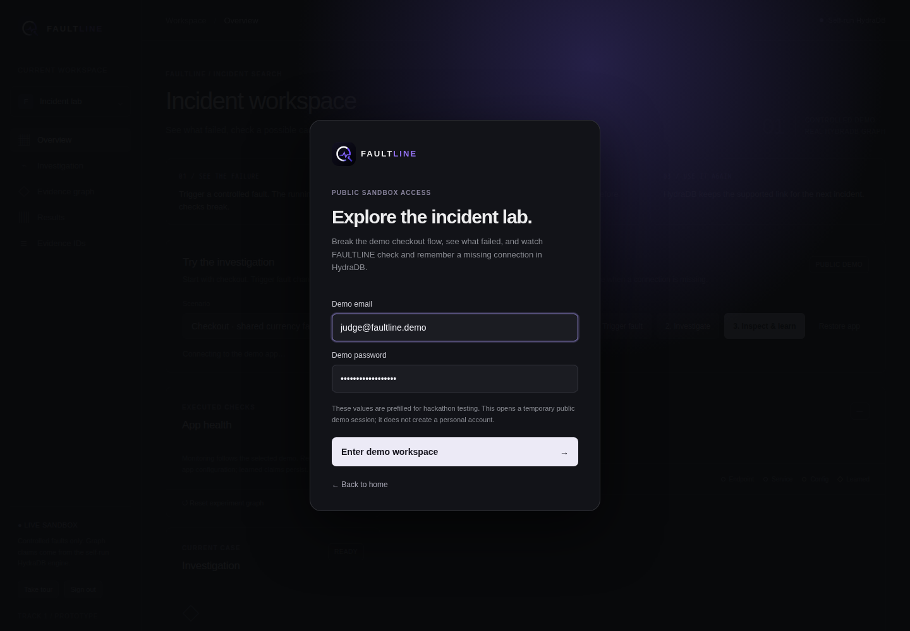
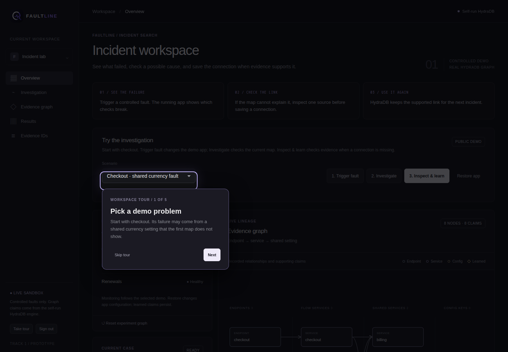
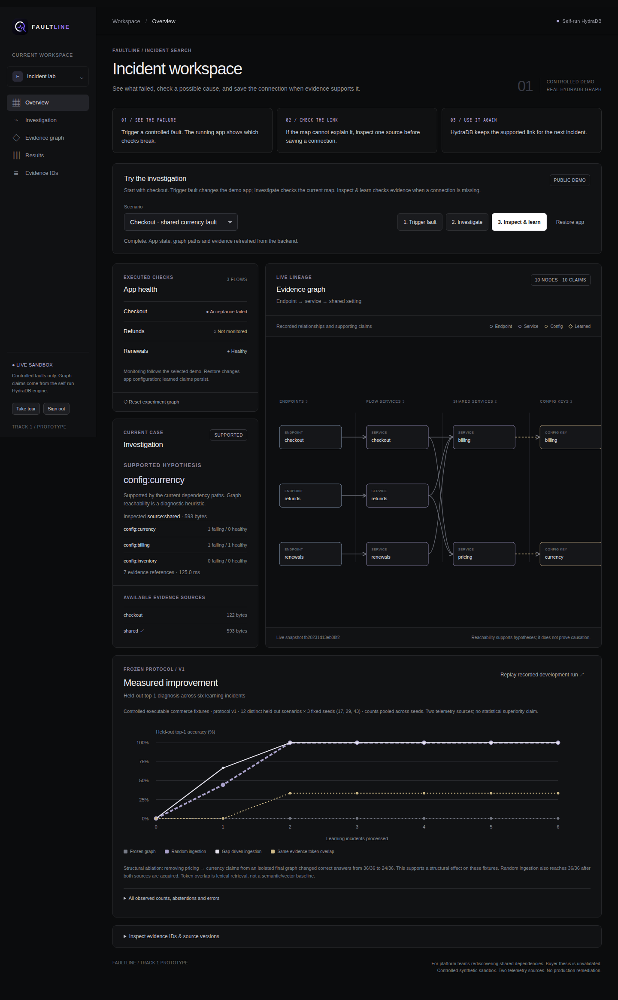
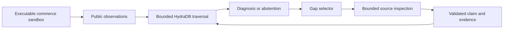

# FAULTLINE

When an app breaks, the visible error may be far from the setting that caused it. **FAULTLINE shows what failed, checks evidence for a missing connection, and remembers that connection in HydraDB for the next investigation.** It is a working prototype on a controlled commerce app.

**[Open the live demo](https://faultline-j7kn.onrender.com)** · **[Judge guide](docs/JUDGE_GUIDE.md)** · **[Three-minute walkthrough script](docs/LOOM_SCRIPT.md)** · **[Deployment guide](docs/HOSTING.md)**


The live demo runs the [open-source HydraDB engine](https://github.com/hydra-db/hydradb) in its Docker image. Render's free disk is ephemeral; allow a cold start after inactivity.

### The problem, in one example

Checkout fails after a shared currency setting changes. A service map shows checkout and pricing, but it does not yet show that pricing reads that setting. The initial search says **insufficient evidence**. When you select **Inspect & learn**, FAULTLINE checks one bounded telemetry source, saves the supported connection with its evidence, and uses it when a later refunds incident needs the same path. The person chooses when to start learning and what to fix; this prototype does not connect to a real company system.

This is our [November HydraDB hackathon](https://luma.com/bqwllms4) Track 1 entry: a graph that improves through evidence-backed investigations. The event page asks entrants to make the graph earn its place over a vector store. [The judge guide](docs/JUDGE_GUIDE.md) points to the live workflow, actual HydraDB traversal, measured baselines, and the limits of our exploratory vector comparison.

## Explore in two minutes

1. Open the [live site](https://faultline-j7kn.onrender.com) and select **Open workspace**.
2. The public test email and password are already filled in. Select **Enter demo workspace**, then use the five-step tour or **Skip tour**. **Take tour** in the sidebar replays it later.
3. Select **Reset experiment graph**, **Trigger fault**, **Investigate**, then **Inspect & learn**. The first diagnosis abstains; learning adds evidence-backed HydraDB claims and supports a currency configuration hypothesis.
4. Select **Restore app**, switch to the refunds transfer incident, and investigate again. The saved path supports that separate incident without another inspection.

The test sign-in creates an eight-hour server-side demo cookie. It is a shared public entry flow, **not a private account or a security boundary**. Sandbox API routes remain public under the configured host and origin rules. Sessions end on sign-out or service restart; the tour completion flag stays only in that browser's local storage.

| Public demo access | Guided tour | Live investigation |
|:--:|:--:|:--:|
|  |  |  |

The [mobile workspace screenshot](docs/images/mobile-workspace.png) shows the same controls at a 390-pixel viewport. These README images came from an isolated Chromium run against a local server backed by the real HydraDB container. [The latest browser report](artifacts/T30-browser-report.json) points to a separate passing run against the public Render URL.

## How it works



Each learned relationship carries a source hash/version and evidence ID. Diagnosis follows actual endpoint, service, claim, and evidence paths from HydraDB; reachability supports a hypothesis and does not prove causation. See [architecture](docs/ARCHITECTURE.md), [frozen evaluation rules](docs/EVALUATION.md), and [design decisions](docs/DECISIONS.md).

### Repository guide

- [`src/faultline/`](src/faultline/) holds the sandbox, bounded graph adapter, diagnosis, evidence validation, learning, and public HTTP API.
- [`web/`](web/) contains the buildless landing and workspace; the tour is in [`web/onboarding.js`](web/onboarding.js).
- [`tests/`](tests/) checks API boundaries, graph behavior, and learning invariants. [`scripts/`](scripts/) contains live integration, browser, hosting, and package checks.
- [`protocol/v1/`](protocol/v1/) freezes the held-out rules. [`artifacts/eval/`](artifacts/eval/) contains raw predictions and aggregates; [`artifacts/T30-browser-report.json`](artifacts/T30-browser-report.json) selects the latest onboarding browser proof.

The browser calls `GET /api/observations`, `/api/graph`, `/api/sources`, and `/api/results` for live or recorded public views. `POST /local/trigger`, `/api/diagnose`, `/api/learn`, `/local/restore`, and `/local/reset-experiment` drive the bounded sandbox workflow. `/api/demo/session`, `/api/demo/sign-in`, and `/api/demo/sign-out` serve the public entry experience. See [`src/faultline/api.py`](src/faultline/api.py) for exact request fields, host checks, and error responses. No route accepts arbitrary graph queries, file paths, or shell commands.

The executable sandbox has checkout, refunds and renewals. It uses no real payment provider. The diagnostic core is deterministic; no LLM or hosted API key is required. The buyer hypothesis is small platform teams rediscovering undocumented shared dependencies. There are no validated customers, savings estimates or production-performance claims.

## Run locally on Windows

Verified environment: Windows 11, Python 3.12.10, Docker Desktop 29.7.2. Commands below run from this project directory in PowerShell.

```powershell
docker desktop start
python -m venv .venv
.venv/Scripts/python.exe -m pip install -r requirements-repro.txt
.venv/Scripts/python.exe -m pip install --no-build-isolation --no-deps -e .
python scripts/start_hydra.py
$env:HYDRADB_TOKEN_FILE = Join-Path (Get-Location) '.runtime/hydra/auth-token'
.venv/Scripts/python.exe scripts/verify_demo.py
.venv/Scripts/python.exe scripts/serve.py
```

Open http://127.0.0.1:8765 for the animated landing page, then select **Open workspace** for the live investigation at http://127.0.0.1:8765/workspace. Use the prefilled public demo values to enter, then complete or skip the tour. The default database and API bind only to loopback. The launcher generates a random local HydraDB authentication file inside ignored `.runtime/`; never print or copy its value. The prefilled UI values are intentionally public and unrelated to the HydraDB secret. The public Render demo is at https://faultline-j7kn.onrender.com; its current free instance has ephemeral storage. See [docs/HOSTING.md](docs/HOSTING.md) for exact deployment checks and limitations.

HydraDB is the official 0.4.0 repository-engine image pinned to `sha256:ab71d651fefee13ebb23eb56d72316065bdca563ff7587442e07be663f2bf880`, commit `916637477f3f34766b4905b270bd4292109d77e6`. It uses the engine HTTP API, not hosted memory search. See [the vendor application guide](https://github.com/hydra-db/hydradb/blob/916637477f3f34766b4905b270bd4292109d77e6/USING-HYDRADB.md) and captured smoke evidence in `artifacts/hydra-smoke/`.

## Demonstrate the learning loop

1. Enter the public demo workspace and skip or complete the first-visit tour. Click **Reset experiment graph**. All three real acceptance checks recover; configuration-read evidence starts uninspected.
2. Select **Checkout · shared currency fault**, then **Trigger fault** and **Investigate**. The initial graph abstains for insufficient evidence.
3. Click **Inspect & learn**. One bounded shared-service telemetry source verifies configuration reads. HydraDB returns the new claim/evidence paths, and diagnosis selects `config:currency`.
4. Click **Restore app**. Runtime health recovers and learned claims persist.
5. Select **Refunds · transfer incident**, trigger it and investigate. A different monitored endpoint uses the learned relationship without fresh inspection.
6. Inspect the measured curve and the recorded development replay. Replay is labeled and does not mutate the live graph.

The web controls operate the live demo process. CLI sandbox state is a separate ephemeral process; its reset does not restore the web process. Do not use a second CLI writer against the running web experiment. Use the web reset controls for that scope.

The landing page restores the user's [Origyn frontend](https://github.com/ParthMalhotra07/origyn)
format: large animated particle hero, product-window preview, scroll reveals,
capability sections and closing invitation (reference commit `44ffbdc`).
Its preview reads the live public API and measured experiment; the separate
workspace controls the real HydraDB demo. On a narrow screen, swipe the
workspace graph and result chart to view their full width.

## Verification and evidence

```powershell
.venv/Scripts/python.exe -m pytest -q
.venv/Scripts/python.exe scripts/verify_evaluation.py
```

The clean-environment check in `artifacts/T22-clean-demo.log` reproduces abstention, actual graph learning, restart persistence, runtime restoration and transfer in a fresh disposable namespace. The browser checks capture screenshots, a video, a trace and console events in `artifacts/ui/`; `latest-attempt.json` points to the last attempt, whose `report.json` explicitly says PASS or FAIL.

The [development timeline](docs/DEVELOPMENT_TIMELINE.md) separates November 14
local evidence from the Git commits actually created on November 15.

For repeatable headless browser QA, without desktop input:

```powershell
.venv/Scripts/python.exe -m pip install -r requirements-ui.txt
python scripts/start_ui_browser.py
$env:FAULTLINE_PLAYWRIGHT_WS = 'ws://127.0.0.1:13000/'
.venv/Scripts/python.exe scripts/verify_ui.py --results
.venv/Scripts/python.exe scripts/verify_onboarding.py
docker stop faultline-ui-browser
```

This uses the pinned official Playwright 1.65.2 Linux image, isolated contexts and a loopback-only local service. It does not connect to a signed-in Chrome profile. Native desktop automation was unreliable here; Windows bundled Chromium failed to launch. Both failures are preserved rather than counted as UI passes.

## Frozen experiment and measured limits

Protocol v1 is frozen in `protocol/v1/`. Learning processes six incidents, yielding seven snapshot points. Final evaluation uses twelve distinct controlled fixtures and three fixed seeds; each aggregate point pools 36 predictions, which are not 36 independent incident types. Final held-out diagnosis is read-only and cannot inspect fresh evidence.

The original completed run is `artifacts/eval/v1-20261114T060320Z-2f47a2/`: 1,044 prediction records, 29 aggregate points and 63 unchanged evaluation snapshot hashes. Adaptive ingestion scored 24/36 after one learning incident versus random ingestion's 16/36; both scored 36/36 after acquiring both sources. Frozen stayed at 0/36. Same-evidence token overlap reached 12/36; it is lexical retrieval, not a vector/semantic baseline. Removing pricing-to-currency claims from the final graph reduced correct predictions to 24/36. These are small synthetic-fixture results, not evidence of general superiority.

The first completed scoring process exited with an error during temporary-directory cleanup after saving its complete results. Those artifacts independently pass `verify_evaluation.py`. Earlier failed startup/scoring attempts are retained. Original text-baseline rows inherited graph timing/citation metadata; corrected rows mark text timing unmeasured and remove those citations, while preserving the originals. No selected answer or scoring count changed. An exact-protocol rerun completed with identical 29 aggregate points and 1,044 structural prediction rows; `artifacts/eval/latest.json` selects it.

An additional **retrospective exploratory** comparison indexes the acquired config-access records in a local Qdrant vector collection with FastEmbed BGE-small. It uses the public incident only to query and rank recent public change targets; private expected answers reach only the outer scorer. Across the same 36 predictions per round, vector retrieval scored 0/36 before acquisition and 12/36 at every later point; adaptive HydraDB scored 0/36, 24/36, then 36/36 from round 2. The 252 raw vector predictions and 21 snapshot hashes are independently recounted by `scripts/verify_vector_exploratory.py`. This tests one fixed vector text representation on the already used synthetic cases. The graph also has eight seeded topology claims; the vector index contains only acquired record text, so this is **not** a full information-equivalent vector architecture or a fresh held-out win. The first exploratory attempt failed on a snapshot-round assertion before aggregation and is retained with its error; v2 corrected that runner check without changing retrieval or scoring rules. See `protocol/vector-exploratory-v2.json` and `artifacts/eval/vector-exploratory/latest.json`.

To reproduce the optional exploratory comparator after installing the base project:

```powershell
.venv/Scripts/python.exe -m pip install -r requirements-vector.txt
.venv/Scripts/python.exe scripts/evaluate_vector_exploratory.py
.venv/Scripts/python.exe scripts/verify_vector_exploratory.py
```

The first run downloads a published embedding model into ignored `.runtime/vector-models`; the runner checks the pinned ONNX file hash and package versions. It writes a separate exploratory run and never changes frozen v1.

To run the unchanged frozen experiment again:

```powershell
.venv/Scripts/python.exe scripts/evaluate.py
.venv/Scripts/python.exe scripts/verify_evaluation.py
```

The runner verifies input hashes before and after execution and reconstructs isolated HydraDB snapshots. Do not tune ranking, selection, budgets or fixtures on these held-out results. Changes to experimental rules need a new experiment version and fresh holdout or an exploratory label.

Load evidence in `artifacts/load/` is separate: 500 requests at each of 1/5/10 clients, on a generated 300-node/200-edge graph, with zero errors in the recorded run. It measures bounded warm two-hop retrieval on this local Docker deployment, not production incident diversity or scale. Raw timings and hardware/resource limits are saved there.

## Boundaries and remaining work

Only two telemetry sources exist in this prototype, so knowledge saturates quickly. Faults vary values, workloads and change order on one fixed topology with generic symptom vocabulary. Reified claims are committed only with evidence, source hashes and versions; graph reachability supports hypotheses and does not prove causation. Ambiguity, abstention and infrastructure errors are preserved.

This is a single-writer local demo with function-level acceptance checks. It is not a production service, remediation agent or authenticated multi-user application. `.runtime/` stores local graph manifests and credentials and is excluded from source packaging. Private evaluator fixtures and raw predictions are never served through the public API or source catalog.

The [November event page](https://luma.com/bqwllms4) states that the 48-hour build ends **November 16, 2026 at 9:00 AM IST**. The host additionally asked for a usable live app link, an open-source GitHub repo and a Loom walkthrough, according to the builder. The bundled self-hosted HydraDB image is live on Render and passed public browser and graph workflow checks. The free instance has no persistent disk, so hosted restart persistence is unverified. Repository visibility, Loom publication and organizer submission must be confirmed separately. See the [submission checklist](docs/SUBMISSION.md) for those delivery steps.

## License and attribution

FAULTLINE's own code and documentation are available under the [MIT License](LICENSE). The self-run [HydraDB engine](https://github.com/hydra-db/hydradb) is a separate upstream project under its own AGPL-3.0 license. The frontend was adapted from the builder's [Origyn project](https://github.com/ParthMalhotra07/origyn); incident data and workflows here belong to FAULTLINE.
