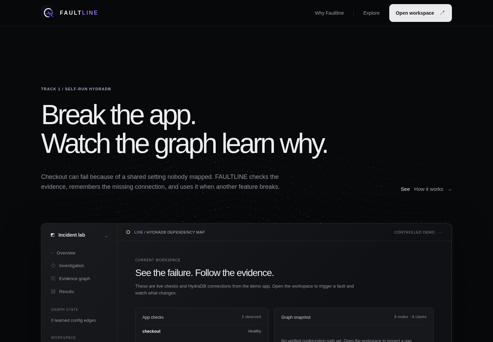
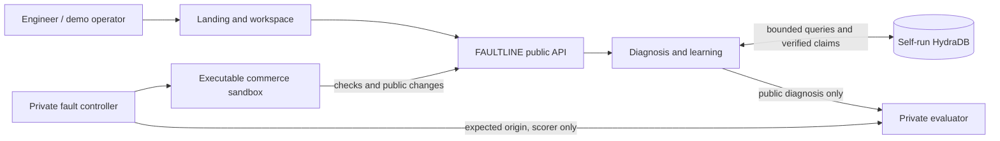
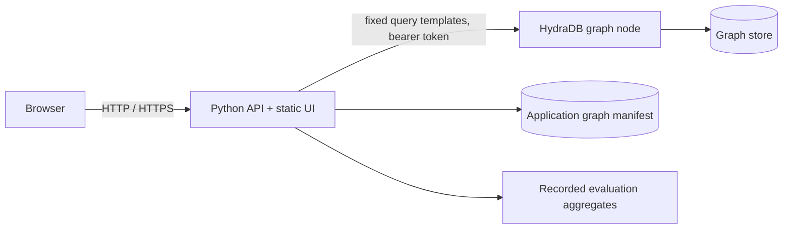
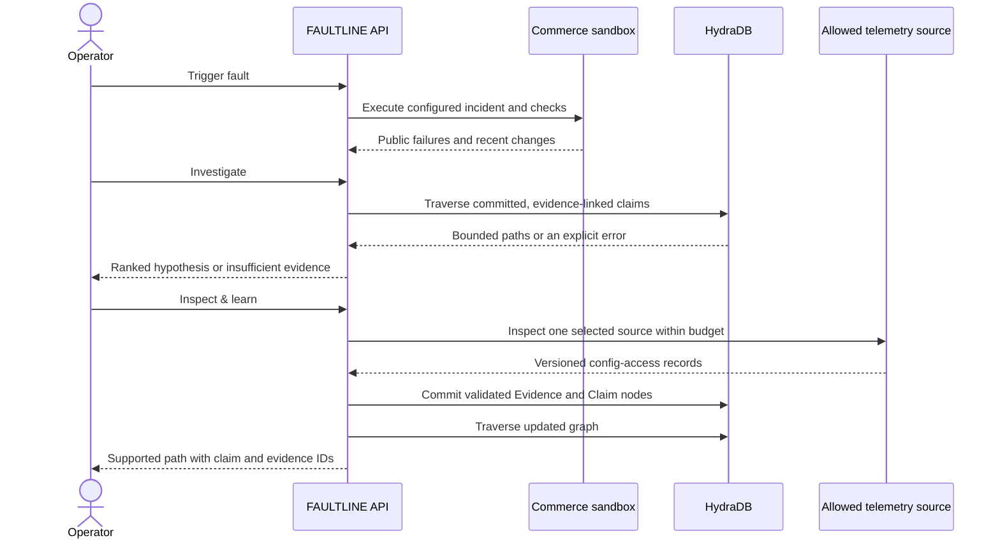
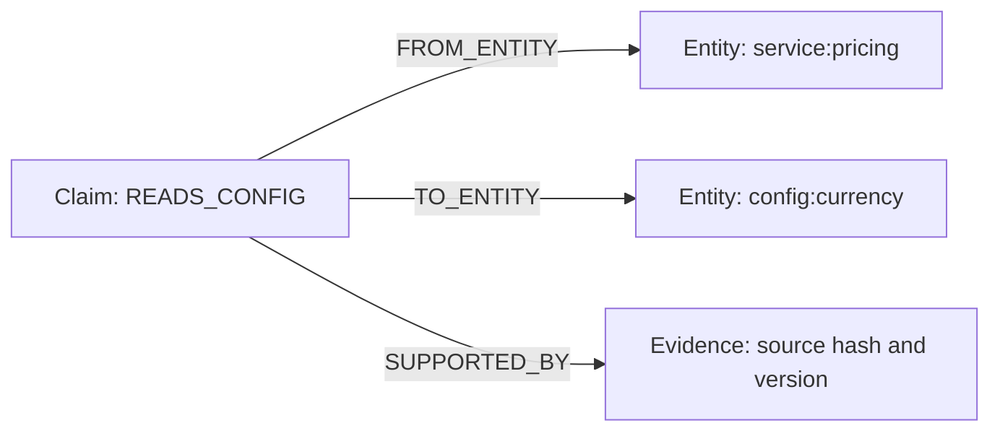

# FAULTLINE

When an app breaks, the visible error may be far from the setting that caused it. **FAULTLINE shows what failed, checks evidence for a missing connection, and remembers that connection in HydraDB for the next investigation.** It is a working prototype on a controlled commerce app.

**[Open the live demo](https://faultline-j7kn.onrender.com)** · **[Loom walkthrough](https://www.loom.com/share/88c09316b6384173b261ba36a00dc433)** · **[See the demo steps](docs/JUDGE_GUIDE.md)** · **[Run locally](#run-locally-on-windows)** · **[Deployment guide](docs/HOSTING.md)**

## Contents

- [The problem and the demo](#the-problem-in-one-example)
- [Architecture at four levels](#architecture-at-four-levels)
- [Run locally](#run-locally-on-windows)
- [Learning loop](#demonstrate-the-learning-loop)
- [Verification and results](#verification-and-evidence)
- [Scope and limitations](#scope-and-limitations)

**At a glance:** FAULTLINE is a deterministic, single-writer incident-search
prototype for a controlled commerce app. A human triggers the demo fault and
chooses when to inspect evidence. The system traverses the self-run HydraDB
graph, abstains when a supporting path is missing, and commits only validated
claims linked to source evidence. No LLM, hosted HydraDB account, real payment
system, or autonomous remediation is involved.



The live demo runs the [open-source HydraDB engine](https://github.com/hydra-db/hydradb) in its Docker image. Render's free disk is ephemeral; allow a cold start after inactivity.

### The problem, in one example

Checkout fails after a shared currency setting changes. A service map shows checkout and pricing, but it does not yet show that pricing reads that setting. The initial search says **insufficient evidence**. When you select **Inspect & learn**, FAULTLINE checks one bounded telemetry source, saves the supported connection with its evidence, and uses it when a later refunds incident needs the same path. The person chooses when to start learning and what to fix; this prototype does not connect to a real company system.

This is our [November HydraDB hackathon](https://luma.com/bqwllms4) Track 1 entry: a graph that improves through evidence-backed investigations. The event page asks entrants to make the graph earn its place over a vector store. [The judge guide](docs/JUDGE_GUIDE.md) points to the live workflow, actual HydraDB traversal, measured baselines, and the limits of our exploratory vector comparison.

The proposed first buyer is a small platform team that repeatedly rediscovers
shared dependencies during incidents. A future shadow-mode product could read
approved exported telemetry and service metadata, then show evidence-backed
paths for an engineer to review. This is a buyer hypothesis; no customer
interviews, willingness-to-pay result, or production time savings are claimed.

## Explore in two minutes

1. Open the [live site](https://faultline-j7kn.onrender.com) and select **Open workspace**.
2. The public test email and password are already filled in. Select **Enter demo workspace**, then use the five-step tour or **Skip tour**. **Take tour** in the sidebar replays it later.
3. Select **Reset experiment graph**, **Trigger fault**, **Investigate**, then **Inspect & learn**. The first diagnosis abstains; learning adds evidence-backed HydraDB claims and supports a currency configuration hypothesis.
4. Select **Restore app**, switch to the refunds transfer incident, and investigate again. The saved path supports that separate incident without another inspection.

The test sign-in creates an eight-hour server-side demo cookie. It is a shared public entry flow, **not a private account or a security boundary**. Sandbox API routes remain public under the configured host and origin rules. Sessions end on sign-out or service restart; the tour completion flag stays only in that browser's local storage.


More views: [demo entry](docs/images/demo-access.png) · [guided tour](docs/images/guided-tour.png) · [mobile workspace](docs/images/mobile-workspace.png).

## Architecture at four levels

These diagrams describe the implemented demo. Each component links to the
source that runs it.

### Level 0 — Product and trust boundary

An engineer sees failing checks and recent changes, investigates, and chooses
whether to inspect a permitted telemetry source. The private fault controller
creates controlled incidents for the demo and evaluation; it does not provide
the expected answer to the investigator. The live workspace reads public
observations and HydraDB-backed results.



The demo is a hypothesis engine. A reachable path explains why a candidate is
worth investigating; it does not establish causation or repair the application.

### Level 1 — Running processes and deployment

[`Dockerfile.demo`](Dockerfile.demo) packages the pinned open-source HydraDB
engine and the Python app in one container. [`scripts/run_hosted.sh`](scripts/run_hosted.sh)
starts the graph node, waits for its readiness endpoint, then starts the app.
HydraDB's query API stays on container loopback; the browser talks only to the
FAULTLINE HTTP server. Local development can instead start HydraDB with
[`scripts/start_hydra.py`](scripts/start_hydra.py) and run the app separately.



The hosted image uses `/data` for the graph store, cache, token file and
experiment manifests. A durable mount can preserve those files. The current
Render free instance has **ephemeral storage**, so persistence across a hosted
spin-down or redeploy has not been verified. Local Docker restart persistence
was tested with a mounted volume; see [hosting evidence](docs/HOSTING.md).

### Level 2 — Components and request flow

| Component | Responsibility | Implementation |
| --- | --- | --- |
| Executable sandbox | Runs checkout, refunds and renewals; produces checks and bounded config-access telemetry | [`sandbox/flows.py`](src/faultline/sandbox/flows.py), [`sandbox/config.py`](src/faultline/sandbox/config.py) |
| HTTP boundary | Serves static UI, public observations, demo controls and measured aggregates; enforces request fields, Host and Origin rules | [`api.py`](src/faultline/api.py), [`web/`](web/) |
| Graph boundary | Sends allowlisted parameterized queries to the pinned HydraDB HTTP API; rejects timeouts, truncation and malformed results | [`graph/adapter.py`](src/faultline/graph/adapter.py), [`graph/store.py`](src/faultline/graph/store.py) |
| Diagnosis | Traverses committed graph paths, ranks recent public candidates and preserves abstention or ambiguity | [`diagnosis/ranker.py`](src/faultline/diagnosis/ranker.py), [`diagnosis/paths.py`](src/faultline/diagnosis/paths.py) |
| Ingestion and learning | Selects one permitted source from public metadata, checks a budget, validates records and commits provenance-backed claims | [`learning/runner.py`](src/faultline/learning/runner.py), [`ingestion/`](src/faultline/ingestion/) |
| Evaluation | Injects controlled faults privately and scores frozen, adaptive, random and ablated snapshots outside the learner | [`evaluation/`](src/faultline/evaluation/), [`protocol/v1/`](protocol/v1/) |

One investigation follows this path:



The browser reads `GET /api/observations`, `/api/graph`, `/api/sources` and
`/api/results`. Bounded demo actions use `POST /local/trigger`,
`/api/diagnose`, `/api/learn`, `/local/restore` and
`/local/reset-experiment`. Public entry uses `/api/demo/session`,
`/api/demo/sign-in` and `/api/demo/sign-out`. See [`api.py`](src/faultline/api.py)
for the exact request fields and errors; the server exposes no arbitrary
Cypher, filesystem path or shell-command endpoint.

### Level 3 — Graph representation and consistency

HydraDB stores `Entity`, `Claim` and `Evidence` nodes. Each dependency is a
reified claim: `Claim -[:FROM_ENTITY]-> Entity`,
`Claim -[:TO_ENTITY]-> Entity` and `Claim -[:SUPPORTED_BY]-> Evidence`.
Initial endpoint-handler and service-call claims come from the versioned app
topology. Config-read claims enter only after source-backed inspection.



The fixed traversal templates cover one to three **domain** edges (each domain
edge takes two graph hops through a Claim) and join Evidence nodes. The adapter
limits requests to 5 seconds and at most 1,000 returned rows by default;
incomplete pages, oversize responses and transport errors become explicit
errors, never an empty successful path. Only committed claims with the current
source version can support diagnosis. The application manifest records active
claims and source hashes; deterministic IDs make retries idempotent. See the
[verified graph queries](src/faultline/graph/queries/verified.json).

The source inspector reads an allowlisted catalog and is constrained by one
source, 10,000 bytes, 100 records and a 1,000 ms inspection budget in the
default learning round. The learner receives public observations and catalog
metadata, never evaluator gold labels. A claim cannot be marked committed
without a matching evidence ID, source hash and version. A failed or incomplete
inspection cannot silently improve the graph. [The evaluation protocol](docs/EVALUATION.md)
defines the separate learning and held-out data paths.

**Why keep a graph here?** The question is whether a recent change can reach
each failing endpoint through specific service dependencies while avoiding
healthy endpoints, and which evidence supports every link. HydraDB performs
that bounded relationship traversal; the application then ranks the returned
paths. Text retrieval can find relevant records, but this implementation
would still need to reconstruct and verify their endpoint-to-service-to-config
connections to produce the same explanation. The [exploratory vector
comparison](#frozen-experiment-and-measured-limits) tests one narrower text
representation and does not prove that a stronger vector-based design could
not solve the problem.

## Run locally on Windows

Verified environment: Windows 11, Python 3.12.10, Docker Desktop 29.7.2. Commands below run from this project directory in PowerShell.

```powershell
docker desktop start
python -m venv .venv
.venv/Scripts/python.exe -m pip install -r requirements-repro.txt
.venv/Scripts/python.exe -m pip install --no-build-isolation --no-deps -e .
python scripts/start_hydra.py
$env:HYDRADB_TOKEN_FILE = Join-Path (Get-Location) '.runtime/hydra/auth-token'
.venv/Scripts/python.exe scripts/verify_demo.py
.venv/Scripts/python.exe scripts/serve.py
```

Open http://127.0.0.1:8765 for the animated landing page, then select **Open workspace** for the live investigation at http://127.0.0.1:8765/workspace. Use the prefilled public demo values to enter, then complete or skip the tour. The default database and API bind only to loopback. The launcher generates a random local HydraDB authentication file inside ignored `.runtime/`; never print or copy its value. The prefilled UI values are intentionally public and unrelated to the HydraDB secret. The public Render demo is at https://faultline-j7kn.onrender.com; its current free instance has ephemeral storage. See [docs/HOSTING.md](docs/HOSTING.md) for exact deployment checks and limitations.

HydraDB is the official 0.4.0 repository-engine image pinned to `sha256:ab71d651fefee13ebb23eb56d72316065bdca563ff7587442e07be663f2bf880`, commit `916637477f3f34766b4905b270bd4292109d77e6`. It uses the engine HTTP API, not hosted memory search. See [the vendor application guide](https://github.com/hydra-db/hydradb/blob/916637477f3f34766b4905b270bd4292109d77e6/USING-HYDRADB.md) and the [graph integration test](tests/integration/test_graph_store.py).

### Configuration and operating boundaries

| Setting | Local development | Hosted demo |
| --- | --- | --- |
| HydraDB authentication | `HYDRADB_TOKEN_FILE` points to the generated, ignored local file | `HYDRADB_TOKEN` is configured in the host's secret settings and written to `/data/auth-token` at startup |
| Graph API | `HYDRADB_URL` defaults to `http://127.0.0.1:18443` | Bundled engine listens on container loopback; its query port is not public ingress |
| Web listener | `scripts/serve.py` defaults to `127.0.0.1:8765` | Binds to `0.0.0.0` and the host's `PORT` |
| Public-origin rule | Loopback Host for local work | `FAULTLINE_PUBLIC_ORIGIN` must equal the external HTTPS origin; Render also supplies `RENDER_EXTERNAL_URL` |
| State | Ignored `.runtime/` and the local graph store | `/data` holds the engine and experiment state; persistence requires a durable host disk |

Do not put HydraDB tokens into a URL, browser, README, log, or commit. The
prefilled demo email and password are deliberately public test values; they
provide an eight-hour in-memory UI session, **not** private authentication.
The sandbox API remains reachable under its Host and same-origin rules.
This prototype has one writer and no customer tenancy or production connector.

## Demonstrate the learning loop

1. Enter the public demo workspace and skip or complete the first-visit tour. Click **Reset experiment graph**. All three real acceptance checks recover; configuration-read evidence starts uninspected.
2. Select **Checkout · shared currency fault**, then **Trigger fault** and **Investigate**. The initial graph abstains for insufficient evidence.
3. Click **Inspect & learn**. One bounded shared-service telemetry source verifies configuration reads. HydraDB returns the new claim/evidence paths, and diagnosis selects `config:currency`.
4. Click **Restore app**. Runtime health recovers and learned claims persist.
5. Select **Refunds · transfer incident**, trigger it and investigate. A different monitored endpoint uses the learned relationship without fresh inspection.
6. Inspect the measured curve and the recorded development replay. Replay is labeled and does not mutate the live graph.

The web controls operate the live demo process. CLI sandbox state is a separate ephemeral process; its reset does not restore the web process. Do not use a second CLI writer against the running web experiment. Use the web reset controls for that scope.

The landing page restores the user's [Origyn frontend](https://github.com/ParthMalhotra07/origyn)
format: large animated particle hero, product-window preview, scroll reveals,
capability sections and closing invitation (reference commit `44ffbdc`).
Its preview reads the live public API and measured experiment; the separate
workspace controls the real HydraDB demo. On a narrow screen, swipe the
workspace graph and result chart to view their full width.

## Verification and evidence

After starting local HydraDB, run from the repository root:

```powershell
$env:HYDRADB_TOKEN_FILE = Join-Path (Get-Location) '.runtime/hydra/auth-token'
.venv/Scripts/python.exe -m pytest -q
.venv/Scripts/python.exe scripts/verify_evaluation.py
```

The recorded full suite passed **50 tests**, including integration checks
against the self-run HydraDB engine. A fresh bundled-image check completed
trigger, abstain, learn and graph traversal. Isolated Chromium passed eight
landing and ten workspace checks against the public Render URL. The selected
check outputs are in [verification evidence](artifacts/verification/).

For repeatable headless browser QA, without desktop input:

```powershell
.venv/Scripts/python.exe -m pip install -r requirements-ui.txt
python scripts/start_ui_browser.py
$env:FAULTLINE_PLAYWRIGHT_WS = 'ws://127.0.0.1:13000/'
.venv/Scripts/python.exe scripts/verify_ui.py --results
.venv/Scripts/python.exe scripts/verify_onboarding.py
docker stop faultline-ui-browser
```

This uses the pinned official Playwright 1.65.2 Linux image and isolated
browser contexts. The checks exercise the rendered controls and report
console, page and unexpected request errors.

## Frozen experiment and measured limits

Protocol v1 is frozen in `protocol/v1/`. Learning processes six incidents, yielding seven snapshot points. Final evaluation uses twelve distinct controlled fixtures and three fixed seeds; each aggregate point pools 36 predictions, which are not 36 independent incident types. Final held-out diagnosis is read-only and cannot inspect fresh evidence.

**Primary metric:** correct top-ranked origin divided by *all attempted* held-out
cases. Wrong answers, abstentions, ambiguity and errors stay in the
denominator. The recorded counts are:

| Method | Before learning | After one incident | After two incidents | Final round |
| --- | ---: | ---: | ---: | ---: |
| Gap-driven HydraDB acquisition | 0/36 | **24/36** | 36/36 | 36/36 |
| Equal-budget random acquisition | 0/36 | 16/36 | 36/36 | 36/36 |
| Frozen graph | 0/36 | 0/36 | 0/36 | 0/36 |
| Same-evidence token overlap | 0/36 | 0/36 | 12/36 | 12/36 |

The adaptive advantage is at the **first** acquisition. Once the two available
sources are known, adaptive and random tie. Removing pricing-to-currency
claims in an isolated final graph changes 36/36 correct to **24/36**. That
ablation shows this relationship matters on these fixtures. Token overlap is
a lexical baseline, not a semantic/vector method.

The [selected run](artifacts/eval/latest.json) includes 1,044 prediction records,
29 aggregate points and 63 unchanged read-only evaluation snapshots. Its
structural predictions and aggregate counts matched an exact-protocol rerun.
The [raw predictions](artifacts/eval/v1-20261114T064609Z-31b50c/predictions.jsonl)
and [evaluation verifier](scripts/verify_evaluation.py) make the counts
inspectable. These are controlled cases on one topology, not a general
accuracy claim.

An additional **retrospective exploratory** comparison indexes acquired
config-access records in local Qdrant with FastEmbed BGE-small. This fixed
vector representation reached 12/36 after acquisition; adaptive HydraDB
reached 24/36 after one incident and 36/36 after two. The graph also had eight
seeded topology claims that the vector corpus lacked, so this is not an
information-equivalent comparison or a general claim against vector stores.
See the [separate protocol](protocol/vector-exploratory-v2.json),
[raw results](artifacts/eval/vector-exploratory/latest.json) and
[verifier](scripts/verify_vector_exploratory.py).

To reproduce the optional exploratory comparator after installing the base project:

```powershell
.venv/Scripts/python.exe -m pip install -r requirements-vector.txt
.venv/Scripts/python.exe scripts/evaluate_vector_exploratory.py
.venv/Scripts/python.exe scripts/verify_vector_exploratory.py
```

The first run downloads a published embedding model into ignored `.runtime/vector-models`; the runner checks the pinned ONNX file hash and package versions. It writes a separate exploratory run and never changes frozen v1.

To run the unchanged frozen experiment again:

```powershell
.venv/Scripts/python.exe scripts/evaluate.py
.venv/Scripts/python.exe scripts/verify_evaluation.py
```

The runner verifies input hashes and reconstructs isolated HydraDB snapshots.
The [evaluation protocol](docs/EVALUATION.md) explains the split and leakage
controls.

Load evidence in `artifacts/load/` is separate: 500 requests at each of 1/5/10 clients, on a generated 300-node/200-edge graph, with zero errors in the recorded run. It measures bounded warm two-hop retrieval on this local Docker deployment, not production incident diversity or scale. Raw timings and hardware/resource limits are saved there.

## Scope and limitations

Only two telemetry sources exist in this prototype, so knowledge saturates quickly. Faults vary values, workloads and change order on one fixed topology with generic symptom vocabulary. Reified claims are committed only with evidence, source hashes and versions; graph reachability supports hypotheses and does not prove causation. Ambiguity, abstention and infrastructure errors are preserved.

This is a single-writer local demo with function-level acceptance checks. It is not a production service, remediation agent or authenticated multi-user application. `.runtime/` stores local graph manifests and credentials and is excluded from source packaging. Private evaluator fixtures and raw predictions are never served through the public API or source catalog.

The public demo is hosted on Render's free plan. Its disk is ephemeral, so graph
state may reset after inactivity or redeployment. A production version would
need durable storage, controlled data connectors, access control and
independent validation on real incidents.

## License and attribution

FAULTLINE's own code and documentation are available under the [MIT License](LICENSE). The self-run [HydraDB engine](https://github.com/hydra-db/hydradb) is a separate upstream project under its own AGPL-3.0 license. The frontend was adapted from the builder's [Origyn project](https://github.com/ParthMalhotra07/origyn); incident data and workflows here belong to FAULTLINE.
